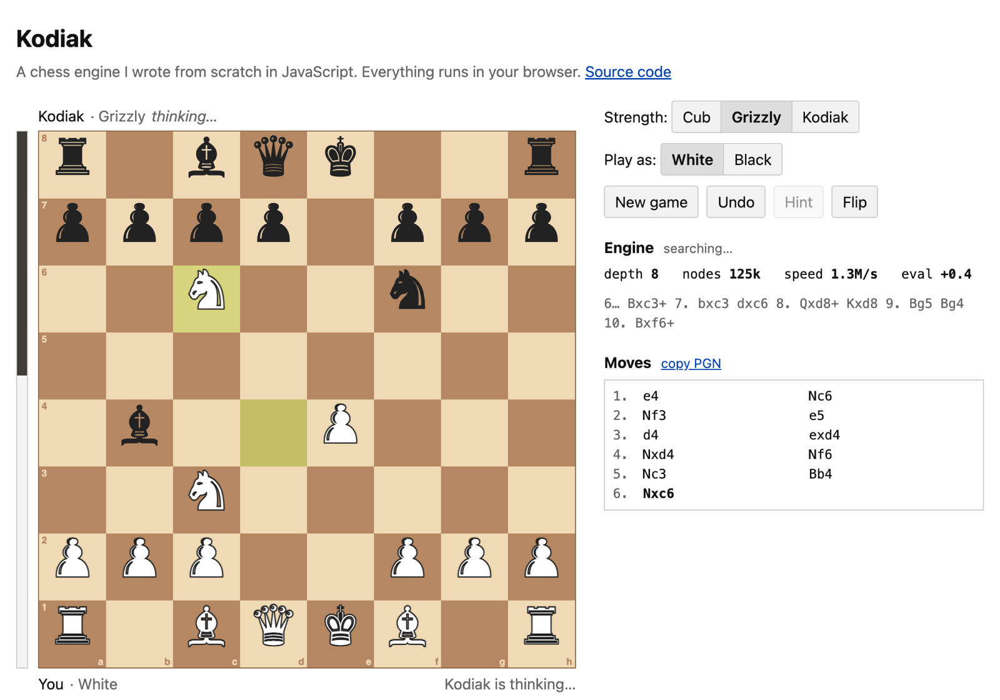

# Kodiak

A chess engine I wrote from scratch in JavaScript. You can play it in the browser here: **https://burthebear.github.io/kodiak/**




It knows all the rules, including castling, en passant, promotion, threefold repetition and the fifty-move rule. On my laptop it searches about 2 million positions a second and gets 10 to 14 moves deep in two seconds. There are no dependencies and no build step: the engine is one file, `src/engine.js`, about 900 lines.

## How it works

The board is a 0x88 array: 128 slots where only 64 are real squares. A square is off the board exactly when `square & 0x88` is non-zero, so checking for edges while generating moves is a single bit test.

The search is negamax alpha-beta with iterative deepening. It searches depth 1, then 2, then 3, and so on until time runs out. Each pass stores the best move for every position in a transposition table, so the next pass tries the strongest moves first and alpha-beta can cut most of the tree. On top of that:

- **Null-move pruning:** if skipping my turn still leaves me winning, the position is good enough and the search moves on.
- **Late-move reductions:** quiet moves that the ordering ranked low are searched shallower first, and re-searched only if they look good.
- **Quiescence search:** at the end of the search, captures keep being played out. Without this the engine would stop in the middle of a trade and badly misjudge the position.

Move ordering is the hash move first, then captures (most valuable victim, least valuable attacker), then "killer" moves that caused cutoffs at the same depth, then a history score.

The evaluation counts material and uses piece-square tables. These are blended from middlegame to endgame values as pieces come off: the king should hide early and walk to the center late. It also knows about doubled, isolated and passed pawns, rooks on open files, and the bishop pair.

The engine runs in a Web Worker, so the board doesn't freeze while it thinks. It sends back its depth, speed, evaluation and expected line after every iteration, which is what the panel on the right shows.

## Testing

```bash
npm test
```

The main test is **perft**. It counts every legal move sequence to a fixed depth and compares the total against known answers. If castling rights, en passant or pins are even slightly wrong, the numbers stop matching. These are the positions it checks; the same test runs in CI on every push:

| Position | Depth | Nodes |
|---|---:|---:|
| Start position | 4 | 197,281 |
| Kiwipete | 3 | 97,862 |
| Rook endgame | 5 | 674,624 |
| Promotions | 4 | 422,333 |
| Castling edge cases | 3 | 62,379 |
| Middlegame | 3 | 89,890 |

There are also tests for FEN parsing, hashing, move notation, draws and checkmate, and a few search puzzles (mate in one, mate in two, winning a hanging queen).

`npm run bench` prints speed numbers. On an Apple Silicon MacBook with Node 26, move generation runs at about 10 million positions a second.

## Running it

It's a static site, so any file server works:

```bash
python3 -m http.server 8000
```

Then open http://localhost:8000.

## Things I'd like to add

An opening book, so games aren't always the same. Automatic tuning of the evaluation weights from self-play. UCI support, so it can play other engines.

MIT license.
