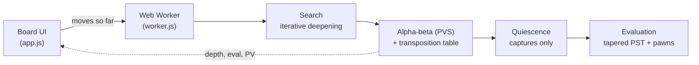

<div align="center">


# Kodiak

**A chess engine written from scratch in JavaScript. Play it in your browser.**

[**▶ Play now**](https://burthebear.github.io/kodiak/) &nbsp;·&nbsp; [How it works](#how-it-works) &nbsp;·&nbsp; [Testing](#testing)


</div>

## Highlights

- **Every rule of chess**, including castling through check, en passant, under-promotion, threefold repetition, the fifty-move rule and insufficient material.
- **Verified move generator.** It matches published *perft* node counts on 6 standard test positions, more than 1.6 million positions in total, on every push in CI.
- **Real search.** It reaches depth 10–14 in two seconds at about 1.7 million positions per second. That uses alpha-beta, a transposition table, null-move pruning and late-move reductions.
- **Runs off the main thread.** The engine runs in a Web Worker and streams depth, speed, evaluation and its expected line to the UI live.
- **Zero dependencies and no build step.** About 900 lines of engine code, plus a static site you can host anywhere.
- **Shareable games.** Each move is stored in the URL, so any position can be sent as a link.

## How it works



| Layer | What it does | Why it matters |
|---|---|---|
| **Board** | 0x88 mailbox: 128 squares, where `square & 0x88` is non-zero exactly when a square is off the board. | Edge detection costs one bit test, so move generation needs no lookup tables. |
| **Hashing** | Zobrist keys are updated incrementally on every move. Two 32-bit halves give a 64-bit key without `BigInt`. | Detects transpositions and repetitions in O(1). |
| **Search** | Iterative deepening negamax with principal-variation search. Each depth uses the previous depth's best moves first. | Good move ordering lets alpha-beta skip most of the tree. |
| **Pruning** | Transposition-table cutoffs, null-move pruning, late-move reductions, mate-distance pruning and a check extension. | The search goes deeper in the same time without missing forced lines. |
| **Move ordering** | TT move first, then captures by MVV-LVA (most valuable victim, least valuable attacker), then killer moves and the history heuristic. | Strong moves are tried first, so cutoffs come early. |
| **Quiescence** | At the horizon, only captures are searched until the position is quiet. Delta pruning trims hopeless ones. | Avoids the *horizon effect*: stopping mid-exchange and misjudging the position. |
| **Evaluation** | Material and piece-square tables, blended from middlegame to endgame by remaining material. Adds doubled, isolated and passed pawns, rooks on open files, and the bishop pair. | The king hides in the middlegame and centralises in the endgame. Passed pawns become more valuable as pieces come off. |

## Testing

```bash
npm test        # perft, rules, notation and search tests (Node 20+)
npm run bench   # speed benchmark
```

**Perft** counts every legal move sequence to a fixed depth and compares the total to a known answer. One bug in castling rights, en passant or pin handling changes the count, so this is the standard way to prove a move generator correct.

| Position | Depth | Nodes | Status |
|---|---:|---:|:---:|
| Start position | 4 | 197,281 | ✅ |
| "Kiwipete" (castling, pins, en passant) | 3 | 97,862 | ✅ |
| Rook endgame (discovered checks) | 5 | 674,624 | ✅ |
| Promotions | 4 | 422,333 | ✅ |
| Tricky castling | 3 | 62,379 | ✅ |
| Middlegame | 3 | 89,890 | ✅ |

Other tests cover FEN round-trips, incremental hashing, SAN notation (disambiguation, promotion, `+`/`#`), game-ending rules, and finding mate in 1, mate in 2 and hanging material.

**Benchmark** (Node 26, Apple Silicon laptop):

| | Result |
|---|---|
| Perft, start position depth 5 (4.87M nodes) | 0.51 s, **9.6M nodes/s** |
| Perft, Kiwipete depth 4 (4.09M nodes) | 0.39 s, **10.4M nodes/s** |
| Search, 2 s per position | depth 10–14, **1.7–2.1M nodes/s** |

## Run it locally

No install needed. Any static file server works:

```bash
git clone https://github.com/BurTheBear/kodiak.git
cd kodiak
python3 -m http.server 8000   # then open http://localhost:8000
```

## Project layout

```
src/engine.js    board, move generation, evaluation, search (the engine)
src/worker.js    runs the search in a Web Worker
app.js           board UI: drag-and-drop, promotion, eval bar, move list
tests/           node:test suite (perft, rules, search)
bench.js         speed benchmark
```

## What's next

- [ ] Opening book for more varied games
- [ ] Bitboard move generation to compare against 0x88
- [ ] Tune the evaluation weights automatically from self-play games (Texel tuning)
- [ ] UCI protocol support, so Kodiak can play other engines in tournaments

## License

MIT © Atharv Sharma
